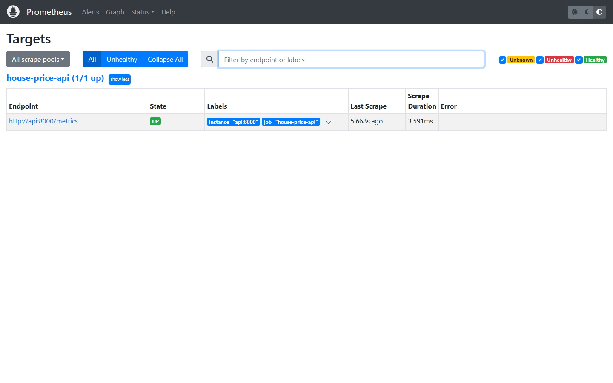
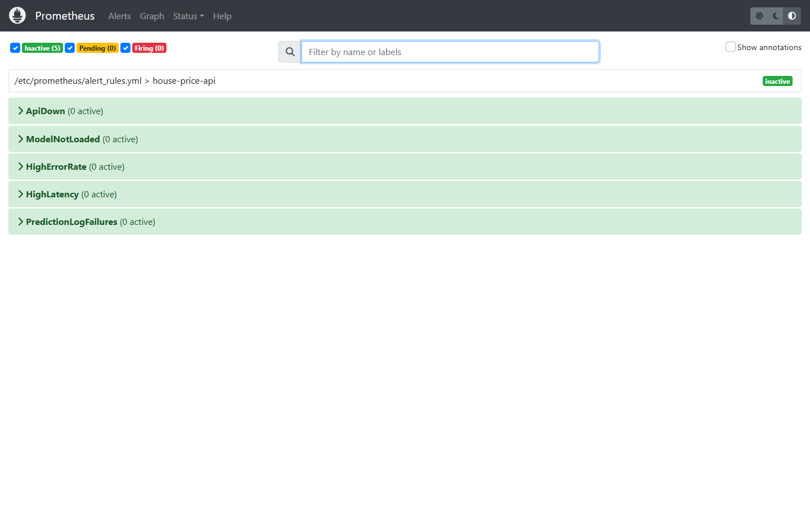

# Modern MLOps Platform — End-to-End Production Stack

Plateforme MLOps complète, locale, sécurisée et reproductible, bâtie sur les standards industriels open-source pour la prédiction de prix immobiliers (dataset Ames Housing).

## 🚀 Technologies & Composants

- **Traitement de données & Feature Store** : PySpark 3.5, Feast 0.47
- **Suivi d'expériences & Registre de modèles** : MLflow 2.22
- **Service d'inférence en ligne** : FastAPI, Uvicorn, Pydantic V2
- **Orchestration des pipelines** : Dagster 1.8 (Software-Defined Assets)
- **Stockage relationnel & Feedback** : PostgreSQL 16
- **Monitoring & Observabilité** : Evidently AI, Prometheus, Grafana
- **Qualité, Tests & CI/CD** : uv, Ruff, Mypy, Pytest, GitHub Actions, Dependabot

---

## 🌐 Accès aux Interfaces & Services Web

Une fois la stack lancée (`docker compose up -d`), les interfaces web suivantes sont accessibles localement :

| Service | URL d'accès | Rôle & Fonctionnalités clés |
|---|---|---|
| **🔥 Prometheus** | [http://localhost:9090](http://localhost:9090) | **Serveur de métriques & Alertes** :<br>• Cibles : [http://localhost:9090/targets](http://localhost:9090/targets) (vérifier que `house-price-api` est `UP`)<br>• Alertes : [http://localhost:9090/alerts](http://localhost:9090/alerts)<br>• Graphiques PromQL : [http://localhost:9090/graph](http://localhost:9090/graph) |
| **📊 Grafana** | [http://localhost:3001](http://localhost:3001) | Tableaux de bord de production (Dashboard pré-provisionné `House Price API`, login `admin` / mdp dans `.env`) |
| **📈 MLflow** | [http://localhost:5000](http://localhost:5000) | Registre de modèles, artefacts (`model_card.md`), paramètres et métriques d'entraînement |
| **⚙️ Dagster UI** | [http://localhost:3000](http://localhost:3000) | Visualisation du graphe des assets, lancement de `training_job` et `monitoring_job` |
| **⚡ Prediction API** | [http://localhost:8000/docs](http://localhost:8000/docs) | Documentation Swagger / OpenAPI interactive (`/predict`, `/feedback`, `/health`, `/ready`) |
| **📏 Métriques brutes** | [http://localhost:8000/metrics](http://localhost:8000/metrics) | Endpoint de métriques brutes scrapé toutes les 15s par Prometheus |

### 📸 Aperçu de Prometheus en production

Captures d'écran issues de l'instance locale (archivées dans [`docs/screenshots/`](docs/screenshots/)) :

#### 1. Cibles de scraping actives (`/targets`)


#### 2. Règles d'alertes configurées (`/alerts`)


### 🔍 Requêtes PromQL utiles dans Prometheus ([http://localhost:9090/graph](http://localhost:9090/graph))
- `up{job="house-price-api"}` : État de santé de la cible de l'API (1 = joignable).
- `sum(rate(http_requests_total[1m])) by (route, status)` : Taux de requêtes par seconde par route et code HTTP.
- `histogram_quantile(0.95, sum by (le) (rate(http_request_duration_seconds_bucket{route="/predict"}[5m])))` : Latence p95 sur `/predict`.
- `prediction_log_failures_total` : Nombre total d'échecs de persistance en base de données PostgreSQL.

---

## 📋 Démarrage rapide

### 1. Configuration de l'environnement
```bash
cp .env.example .env
# Personnalisez les mots de passe et la clé d'API dans .env
```

### 2. Démarrage de la stack
```bash
docker compose up --build -d
docker compose ps
```

### 3. Entraînement initial du modèle
```bash
docker compose exec dagster-daemon dagster job execute -m mlops.orchestration -j training_job
```

### 4. Promotion du champion & Redémarrage de l'API
```bash
docker compose exec api mlops-model status
docker compose exec api mlops-model promote
docker compose restart api
```

### 5. Vérification & Smoke Test
```bash
uv run python scripts/smoke_test.py --api-key "<VOTRE_CLÉ_API>"
```

### 6. Envoi de trafic & Rapport de monitoring
```bash
uv run python scripts/replay_holdout.py --api-key "<VOTRE_CLÉ_API>" --rows 200
docker compose exec dagster-daemon dagster job execute -m mlops.orchestration -j monitoring_job
```

---

## 📚 Documentation complète

- [Operations Runbook](docs/RUNBOOK.md) : Guide d'exploitation complet, architecture Mermaid, procédures d'incident (503, dérive, pannes), matrice des ports et captures d'écran.

---

## 🧪 Tests et Contrôles Qualité

```bash
# Vérification du formatage et des linters
uv run ruff check .
uv run ruff format --check .

# Typage statique
uv run mypy src/

# Tests unitaires et couverture
uv run pytest --cov=src/mlops tests/

# Audit de sécurité
uv run pip-audit --desc
```
