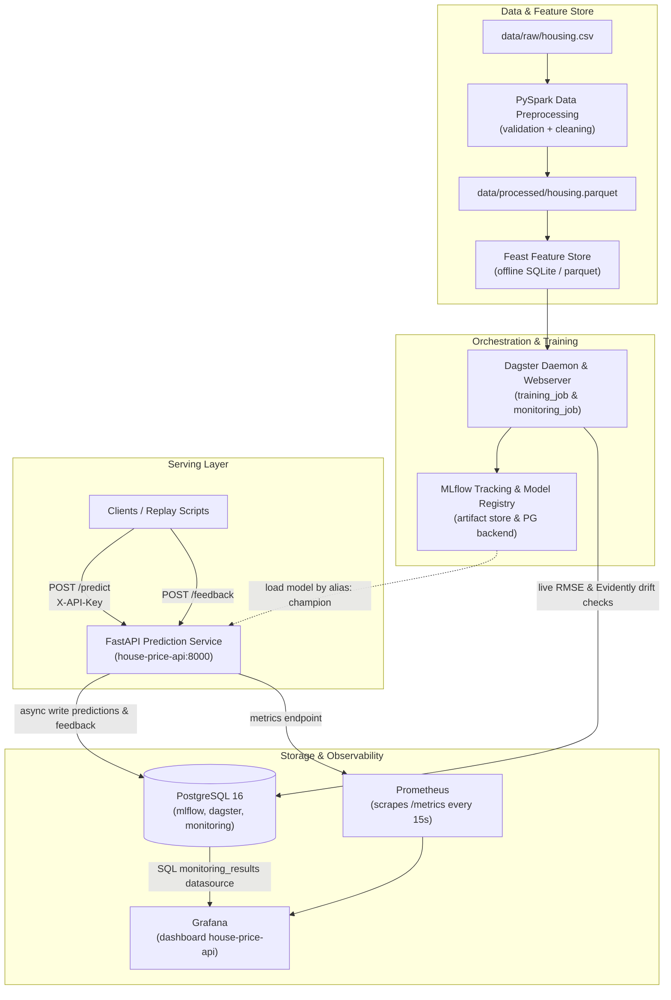
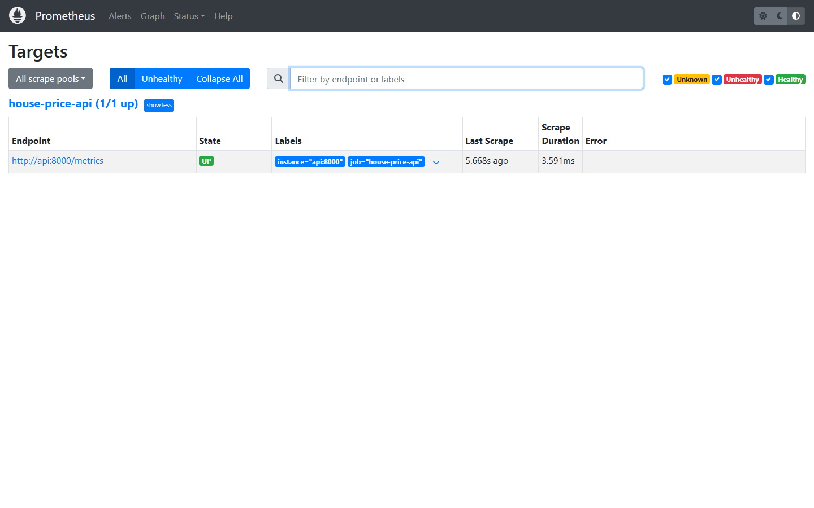
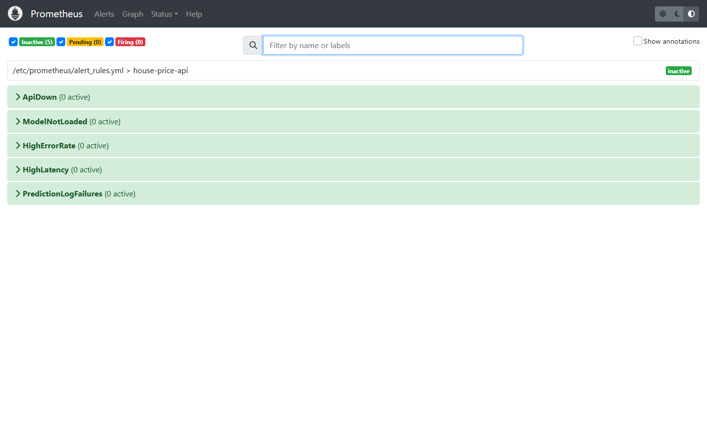
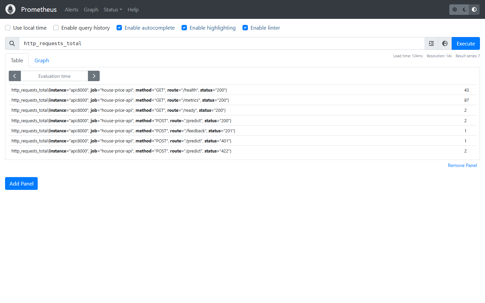

# Operations Runbook — Modern MLOps Platform

Ce document constitue le guide d'exploitation de référence pour la plateforme MLOps locale.
Il couvre l'architecture, le déploiement initial, les commandes d'administration courantes, ainsi que les procédures d'escalade et de remédiation en cas d'incident de production.

---

## 1. Architecture globale de la plateforme

La plateforme est composée de 7 conteneurs orchestrés via Docker Compose, articulés autour de la séparation stricte entre le cycle de vie des modèles, le service d'inférence en ligne et la boucle de rétroaction / observabilité.



### Flux de données et d'actions clés

1. **Pipeline de données** : PySpark valide les données sources selon le schéma strict (taux de nullité, types, bornes métier). Feast gère les feature views et la reproductibilité temporelle (`point-in-time join`).
2. **Entraînement & Gate** : Régression Ridge avec split temporel. Le gate automatique évalue la monotonicité comportementale, le seuil absolu $R^2 \ge 0.70$ et la comparaison face au champion actuel.
3. **Mise en production** : L'API charge dynamiquement la version étiquetée `champion` dans le registre MLflow au démarrage. Aucun déploiement de code ni rebuild d'image n'est requis pour promouvoir un modèle.
4. **Monitoring & Alertes** : L'API enregistre chaque prédiction et son feedback dans PostgreSQL. Le job Dagster `monitoring_job` calcule périodiquement le drift Evidently et le RMSE en direct. Prometheus scrape les latences et statuts HTTP ; Grafana consolide les métriques.

---

## 2. Procédure de premier déploiement pas à pas

### Prérequis système
- Docker Engine $\ge 24.0$ et Docker Compose V2
- `uv` (gestionnaire de packages Python ultra-rapide)
- Python 3.11
- Fichier `.env` configuré à partir du gabarit `.env.example`

### Étape 1 : Initialisation de la configuration
```bash
cp .env.example .env
# Assurez-vous que des mots de passe robustes et une clé API sont renseignés dans .env
```

### Étape 2 : Lancement des conteneurs
```bash
docker compose up --build -d
docker compose ps
```
Attendez que les services `postgres`, `mlflow` et `api` affichent le statut `(healthy)`.

### Étape 3 : Contrôle de disponibilité initial
```bash
curl -i http://localhost:8000/health
# Doit renvoyer HTTP 200 {"status":"ok"}

curl -i http://localhost:8000/ready
# Doit renvoyer HTTP 503 {"detail":"No champion model is loaded."}
```

### Étape 4 : Déclenchement du premier entraînement
Exécutez le job Dagster depuis la CLI du conteneur `dagster-daemon` :
```bash
docker compose exec dagster-daemon dagster job execute -m mlops.orchestration -j training_job
```
Tous les assets (`raw_housing_data`, `processed_housing_data`, `feast_feature_views`, `training_dataset`, `candidate_model`, `holdout_dataset`) sont matérialisés avec succès et la version 1 reçoit l'alias `challenger`.

### Étape 5 : Promotion du premier champion
```bash
docker compose exec api mlops-model status
docker compose exec api mlops-model promote
docker compose restart api
```
Vérifiez que l'API est maintenant prête :
```bash
curl -i http://localhost:8000/ready
# Doit renvoyer HTTP 200 {"status":"ready","model_version":"1"}
```

### Étape 6 : Test de validation (Smoke Test)
```bash
uv run python scripts/smoke_test.py --api-key "<VOTRE_CLE_API>"
```
Toutes les vérifications (`health`, `ready`, `predict`, `feedback`, `rejects invalid key`, `rejects invalid data`, `metrics`) doivent afficher `PASS`.

---

## 3. Commandes d'exploitation courantes

### Réentraînement manuel
Pour exécuter une session d'entraînement hors planification Dagster :
```bash
docker compose exec dagster-daemon dagster job execute -m mlops.orchestration -j training_job
```
Si le nouveau modèle satisfait au gate de sécurité, il est enregistré dans MLflow avec le tag `gate_passed: true` et reçoit l'alias `challenger`.

### Gestion des modèles via la CLI `mlops-model`

| Action | Commande | Description |
|---|---|---|
| **Consulter le statut** | `docker compose exec api mlops-model status` | Affiche le champion et challenger actuels avec leurs scores RMSE |
| **Promouvoir le challenger** | `docker compose exec api mlops-model promote` | Assigne l'alias `champion` au challenger et archive l'ancien champion |
| **Rollback d'urgence** | `docker compose exec api mlops-model rollback` | Rétablit immédiatement le champion précédent |
| **Prise en compte par l'API** | `docker compose restart api` | Recharge le modèle champion sans coupure des autres services |

### Monitoring en direct
Pour calculer immédiatement le rapport de drift et le RMSE de production :
```bash
docker compose exec dagster-daemon dagster job execute -m mlops.orchestration -j monitoring_job
```

### Consultation des logs et métriques

```bash
# Logs de l'API en direct (format JSON structuré)
docker compose logs -f api

# Logs de MLflow
docker compose logs -f mlflow

# Logs de l'orchestrateur Dagster
docker compose logs -f dagster-daemon

# Dernières entrées de monitoring dans PostgreSQL
docker compose exec postgres psql -U app -d monitoring -c \
  "SELECT id, checked_at, check_name, model_version, value, threshold, passed FROM monitoring_results ORDER BY checked_at DESC LIMIT 10;"
```

---

## 4. Procédures de résolution des incidents (Troubleshooting)

### Incident A : L'API renvoie des erreurs HTTP 503 sur `/ready` ou `/predict`
- **Symptôme** : Les requêtes `/ready` renvoient `503 Service Unavailable` avec le message `{"detail":"No champion model is loaded."}`.
- **Diagnostic** :
  1. Vérifier si un modèle possède l'alias `champion` :
     ```bash
     docker compose exec api mlops-model status
     ```
  2. Vérifier la connectivité entre l'API et MLflow :
     ```bash
     docker compose exec api curl -s http://mlflow:5000/health
     ```
- **Résolution** :
  1. Si aucun champion n'est assigné, vérifier s'il existe un challenger validé et le promouvoir :
     ```bash
     docker compose exec api mlops-model promote
     docker compose restart api
     ```
  2. Si aucun modèle n'est disponible dans le registre, exécuter le `training_job` dans Dagster puis promouvoir le modèle résultant.

---

### Incident B : Le pipeline échoue à l'étape `processed_housing_data`
- **Symptôme** : Le job Dagster `training_job` échoue sur l'op `processed_housing_data` avec une exception `ValidationError`.
- **Diagnostic** :
  1. Consulter le rapport de validation généré :
     ```bash
     docker compose exec dagster-daemon cat /app/artifacts/reports/validation.json
     ```
  2. Identifier les champs en anomalie (valeurs hors bornes, taux de nullité excessif, IDs dupliqués).
- **Résolution** :
  1. Corriger les données sources ou isoler le lot corrompu.
  2. Si l'évolution des données est légitime (ex: nouveau quartier, évolution des prix nominaux), mettre à jour les bornes du contrat de données dans `src/mlops/validation.py` et enrichir la suite de tests unitaires `tests/test_validation.py`.
  3. Relancer le `training_job`.

---

### Incident C : Une alerte de Drift ou dégradation de qualité se déclenche
- **Symptôme** : Alerte Prometheus `ModelPerformanceDegraded` ou `InputDataDriftDetected`, ou échec du job `live_quality_check` dans Dagster.
- **Diagnostic** :
  1. Consulter le dernier rapport Evidently HTML archivé dans `artifacts/reports/drift-*.html`.
  2. Consulter la table des checks :
     ```bash
     docker compose exec postgres psql -U app -d monitoring -c \
       "SELECT * FROM monitoring_results WHERE passed = false ORDER BY checked_at DESC LIMIT 5;"
     ```
  3. Comparer le `live_rmse` calculé face au seuil autorisé (`1.5 * holdout_rmse`).
- **Résolution** :
  1. Si le drift provient d'une variation saisonnière ou macro-économique normale, réentraîner un modèle sur les données récentes :
     ```bash
     docker compose exec dagster-daemon dagster job execute -m mlops.orchestration -j training_job
     ```
  2. Si le modèle actuel produit des prédictions erronées suite à une régression, effectuer un rollback immédiat :
     ```bash
     docker compose exec api mlops-model rollback
     docker compose restart api
     ```

---

### Incident D : La base de données PostgreSQL est indisponible ou corrompue
- **Symptôme** : Conteneur `postgres` arrêté ou erreurs de connexion dans les logs de l'API.
- **Comportement attendu du système** :
  - **Résilience** : L'API continue de répondre aux requêtes `/predict` avec un code `200 OK` sans crasher.
  - Le compteur d'échecs `prediction_log_failures_total` s'incrémente dans Prometheus.
- **Diagnostic** :
  ```bash
  docker compose ps postgres
  docker compose logs postgres
  ```
- **Résolution** :
  1. Tenter un redémarrage propre :
     ```bash
     docker compose start postgres
     ```
  2. Si le volume de données est corrompu, recréer les bases de données (le script `docker/postgres-init.sh` réinitialisera automatiquement les utilisateurs `mlflow`, `dagster`, `app` et `grafana`) :
     ```bash
     docker compose stop postgres
     docker compose rm -f postgres
     docker volume rm modern-mlops_postgres-data
     docker compose up -d postgres
     ```
  3. Redémarrer les services dépendants (`mlflow`, `dagster-daemon`, `api`) pour réinitialiser leurs pools de connexion.

---

## 5. Matrice des ports et des accès aux services

| Service | Port externe | Port interne | URL d'accès local | Rôle & Identifiants par défaut |
|---|---|---|---|---|
| **Prediction API** | `8000` | `8000` | `http://localhost:8000` | Service REST FastAPI (Swagger : `/docs`, métriques : `/metrics`, santé : `/health`, `/ready`) |
| **Dagster UI** | `3000` | `3000` | `http://localhost:3000` | Interface d'orchestration des pipelines de données, d'entraînement et de monitoring |
| **MLflow Server** | `5000` | `5000` | `http://localhost:5000` | Serveur de tracking d'expériences et registre de modèles |
| **Grafana** | `3001` | `3000` | `http://localhost:3001` | Tableaux de bord de supervision (Login : `admin` / Password défini dans `.env`) |
| **Prometheus** | `9090` | `9090` | `http://localhost:9090` | Moteur de collecte de métriques TSDB et gestionnaire d'alertes |
| **PostgreSQL** | `5432` | `5432` | `localhost:5432` | Base de données relationnelle (`mlflow`, `dagster`, `monitoring`) |

---

## 6. Captures d'écran de la supervision Prometheus

### A. Cibles de scraping actives (`/targets`)
Vérification que la cible `house-price-api` (`http://api:8000/metrics`) est active et en état `UP` :


### B. Règles d'alertes configurées (`/alerts`)
État des règles de détection d'incidents (indisponibilité de l'API, absence de champion, latence élevée, échecs d'écriture en base) :


### C. Visualisation des métriques & PromQL (`/graph`)
Évolution des requêtes et latences de l'API :

